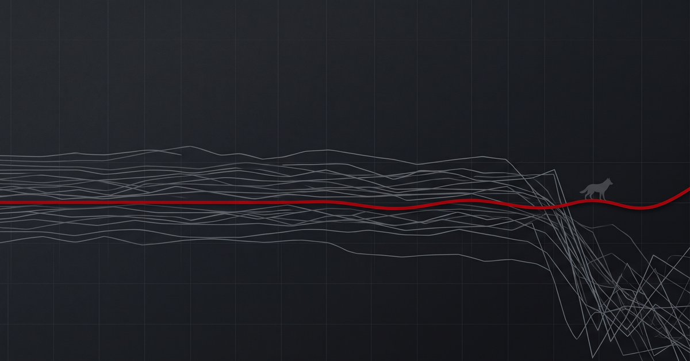

<p align="center"></p>

# Vanguard ETF Challenge 2026: Team WolfPack

Team WolfPack (NC State) in the **2026 Vanguard ETF Fall Trading Challenge**, run by Temple University's Fox School of
Business with Vanguard. This repo has both halves of our entry:

1. **The trading competition** (14 Sep – 6 Nov 2026): four $250,000 StockTrak accounts, Vanguard ETFs only, ranked
   on Sharpe ratio. We built a data pipeline over the full Vanguard ETF lineup, worked out what the scoring rule
   actually rewards, and traded a short-duration book. **We finished as one of the five finalist teams**, selected on
   Sharpe ratio.
2. **The finals pitch** (13 Nov 2026): a 15-minute pitch to Vanguard judges for a new ETF. We proposed a **USD-hedged
   short-term international government bond ETF**, backed by a hedged return series rebuilt from real market prices.

> Educational project. Nothing here is investment advice. The proposed fund is hypothetical; "Vanguard" in its working
> name reflects the competition brief, and this project isn't affiliated with or endorsed by Vanguard.

---

## Contents

- [Part 1: the trading competition](#part-1-the-trading-competition)
- [Part 2: the finals ETF pitch](#part-2-the-finals-etf-pitch)
- [Timeline](#timeline)
- [Repository layout](#repository-layout)
- [Setup](#setup)
- [Reproducing the work](#reproducing-the-work)
- [Data policy: what isn't in this repo](#data-policy-what-isnt-in-this-repo)
- [Team and acknowledgements](#team-and-acknowledgements)

---

## Part 1: the trading competition

### The rules that mattered

| | |
|---|---|
| Accounts | 4 members × $250,000 on StockTrak, Vanguard ETFs only |
| Limits | 25% max per position, cash ≤ 10% per account, at least 5 trades per member, no shorting or margin, $10 commission |
| Window | 14 Sep – 6 Nov 2026 (40 trading days) |
| Score | Sharpe ratio, team score = average of the four account Sharpes. Top 5 teams go to the finals |

Full rules and our pre-trade analysis are in [`docs/challenge_brief.md`](docs/challenge_brief.md).

### The insight: at a 0% risk-free rate, the shortest bonds win

StockTrak computes `(mean daily return − rf) / sd(daily return) × √252`, and this session set `rf` to the 0% cash
interest rate. The numerator is therefore *all* return, not excess return. For a bond fund:

```
return      ≈ carry − duration × Δyield
volatility  ≈ duration × σ(Δyield)
⟹ Sharpe at rf = 0 ≈ carry / (duration × σ(Δyield))
```

Volatility scales with duration but carry barely does, so the ratio is highest as duration goes to zero. On published
yields and measured volatility, VBIL (0–3 month T-bills) scored about 12.6 and VGUS about 11.4, while EDV (extended
duration) scored 0.3: yield ×1.55, volatility ×60. Every team chasing return was, by construction, chasing a lower
score.

### What we built and traded

- **`src/vgdata/`**, a small data layer: Vanguard's public fund-detail feed (SEC yield, expense ratio, inception,
  asset class for all 116 ETFs), Yahoo prices and dividends, FRED T-bill yields, data-quality gates, bid-ask spread
  estimates, Ledoit-Wolf covariance, constrained max-Sharpe optimisation (cvxpy) and HRP.
- **A four-phase pipeline** (`scripts/trading/pipeline/`): data quality → EDA and regime checks → the
  distribution-crediting "sawtooth" question → optimisation and an execution package. Each phase writes a report to
  `reports/`.
- **Book A**, the opening book (17 Sep): about 74% in VBIL, VGUS and VUSB at the 25% cap, plus VGSH, VSDB and a 5%
  minimum-volatility equity sleeve (VFMV), all four accounts identical. We compared it against a teammate's Book B and
  a 75/25 merge and chose Book A on five backtests. The reasoning, including every error we caught in our own work, is
  in [`reports/WOLFPACK_STRATEGY.md`](reports/WOLFPACK_STRATEGY.md).
- **While trading** (`scripts/trading/live/`): we found StockTrak credits distributions with a one-business-day lag,
  re-projected the competition under it, and verified the scoring formula by rebuilding our own account from holdings
  (2.31 against StockTrak's displayed 2.32 on 3 Nov, only with rf = 0 and every day counted). In the final week we
  modelled each rival's book to estimate our odds of a top-5 finish under different positions.

## Part 2: the finals ETF pitch

### The idea

**Vanguard Short-Term International Treasury Index ETF (USD Hedged)** (working name): about 190 developed-market
government bonds outside the US with 1–3 years to maturity (the FTSE WGBI Developed Markets 1–3 Years Capped Select
index), with 100% of the currency hedged back to dollars through rolling one-month forwards. Proposed fee 0.10%.

### The gap

| | Unhedged (you carry currency risk) | Hedged to USD |
|---|---|---|
| **Short term, 1–3 years** | ISHG, BWZ (0.35% fees) | **None in the US market** |
| **All maturities** | BWX, IGOV | BNDX (6.4-year duration), GGOV, SCIN |

In 2022 BNDX lost 12.8%. Its hedge didn't cause that; its duration did. US short Treasuries (VGSH) lost 3.9%. US
investors can't buy hedged foreign government bonds at short duration, and Vanguard already sells that product in
Europe.

### The evidence (rebuilt from real prices, not simulated)

We took ISHG's actual returns (it holds these bonds, unhedged), hedged every currency with real one-month forwards
from Bloomberg for the five major currencies (81% of the fund) and interest-rate gaps for the rest, and moved the fee
to 0.10%. Monthly, February 2015 – October 2026:

| | Our fund (rebuilt) | VGSH | BNDX | 3-month T-bills |
|---|---|---|---|---|
| Return a year, 2016–2025 | **1.94%** | 1.78% | 2.08% | 2.17% |
| Volatility | 1.7% | 1.6% | 4.2% | 0.6% |
| 2022 | **−2.8%** | −3.9% | −12.8% | +1.8% |
| March 2020 | −0.1% | +1.3% | −2.9% | +0.1% |
| Worst drawdown | −4.9% | −5.3% | −14.9% | 0% |
| Correlation with VGSH | **0.69** | 1.00 | 0.62 | 0.33 |

Also:

- **Hedging paid US investors.** Real forwards earned 0.06–0.52 points a year more than the simple rate gap.
- **Bloomberg test.** Hedged 3-month foreign bills beat T-bills by about 10–13 bp a year after fees.
- **Precedent.** Vanguard's Irish-domiciled hedged short-term fund manages $7.7B at 0.10%, with a 2.1% annual return
  over 10 years.
- **What we didn't claim.** The fund doesn't beat T-bills, isn't less risky than VGSH, and costs taxable investors the
  state-tax exemption Treasuries get.

### Pitch materials

| file | what it is |
|---|---|
| [`presentation/WolfPack_Finals_Pitch.pptx`](presentation/WolfPack_Finals_Pitch.pptx) | **The deck as presented** (15 slides plus 6 backup slides for Q&A, with speaker notes) |
| [`presentation/WolfPack_Finals_Speech.pdf`](presentation/WolfPack_Finals_Speech.pdf) | Speech script with a timing table (about 11½ minutes), built from the deck's speaker notes |
| [`presentation/deck/`](presentation/deck/) | Deck source (HTML slides, CSS, `deck.json`) as built. The PPTX carries a few last-minute wording edits made in PowerPoint on 13 Nov. Image paths `/_blob/…` correspond to [`presentation/figures/`](presentation/figures/) |
| [`docs/pitch/WolfPack_Idea1_Final_Review.pdf`](docs/pitch/WolfPack_Idea1_Final_Review.pdf) | 8-page review pack: evidence, 10 assumptions, 12 limitations, the claims we would and wouldn't make, likely judge questions |
| [`docs/pitch/PITCH_FACTS_VERIFIED.md`](docs/pitch/PITCH_FACTS_VERIFIED.md) | Every number in the pitch, with its source and how it was verified |
| [`docs/pitch/IDEA1_DATA_SOURCES_AND_CHOICES.md`](docs/pitch/IDEA1_DATA_SOURCES_AND_CHOICES.md), [`docs/pitch/ETF_PITCH_1_…pdf`](docs/pitch/ETF_PITCH_1_USD-Hedged_Short_International_Government_Bond.pdf) | The first Idea 1 write-up (7 Nov) and its data provenance, before the real-price rebuild replaced the simulation |

## Timeline

| date (2026) | event |
|---|---|
| 14 Sep | Trading opens |
| 16–17 Sep | Data pipeline built; organizer confirms scoring is Sharpe; Book A chosen |
| 23 Sep, 12 Oct | Workshops with Vanguard professionals |
| early Oct | One-business-day distribution-crediting lag observed; competition re-projected |
| 3 Nov | Scoring formula verified by rebuilding our account from holdings |
| 6 Nov | Trading closes; WolfPack named one of five finalists |
| 7–12 Nov | Idea 1 drafted, Bloomberg tests (9 Nov), real-price rebuild, review pack, deck and speech |
| 13 Nov | Finals on Teams: 15-minute pitch and 5-minute Q&A |

## Repository layout

```
├── src/vgdata/                 data + optimisation library (installed with `pip install -e .`)
├── scripts/
│   ├── trading/
│   │   ├── pipeline/           phases 1–5: data quality, EDA, sawtooth, optimisation → reports/
│   │   ├── book_selection/     backtests and tests behind the Book A decision (17–18 Sep)
│   │   └── live/               analyses run while trading: crediting lag, final-week standings
│   └── pitch/                  hedged-series rebuild, Bloomberg-workbook validation, charts, PDF builders
├── reports/                    trading-phase write-ups (start with WOLFPACK_STRATEGY.md); superseded/ for old drafts
├── docs/
│   ├── challenge_brief.md      competition rules, scoring mechanics, market context (16 Sep)
│   ├── trading_plan.md         the phase-gated build plan (historical)
│   └── pitch/                  pitch facts, review pack PDF, first draft, figures
├── presentation/               final deck (PPTX), speech script, deck source, slide charts
├── data/
│   ├── processed/              derived datasets (committed): fund master, returns, quotes, spreads, backtests,
│   │                           real_hedged_ishg_monthly.csv (the rebuilt hedged series)
│   ├── raw/, interim/          re-fetchable feed pulls and price cache (gitignored)
│   └── private/                licensed / third-party inputs (gitignored; see its README)
├── tests/                      guards on the universe filter and return reconstruction
├── assets/                     banner image
├── config.yaml                 every constant: rules, scoring, data sources, modelling choices
└── pyproject.toml, requirements.txt
```

## Setup

Python 3.11.

```bash
python3.11 -m venv .venv
source .venv/bin/activate
pip install -r requirements.txt     # also installs src/vgdata in editable mode
pytest                              # 9 tests
```

Run every script from the repository root; paths are relative to it.

## Reproducing the work

**Pitch outputs (offline, from committed data):**

```bash
python scripts/pitch/final_review_charts.py     # docs/pitch/figures/
python scripts/pitch/slide_charts.py            # presentation/figures/
python scripts/pitch/build_final_review_pdf.py  # docs/pitch/WolfPack_Idea1_Final_Review.pdf
python scripts/pitch/build_speech_pdf.py        # presentation/WolfPack_Finals_Speech.pdf
```

**The hedged series itself** (`scripts/pitch/real_hedged_full.py`) needs network access (Yahoo, FRED) and the team's
Bloomberg workbook in `data/private/bloomberg/`, which isn't public. Its output is committed as
`data/processed/real_hedged_ishg_monthly.csv`.

**Trading pipeline** (network: Vanguard feed, Yahoo, FRED):

```bash
python scripts/trading/pipeline/phase1_report.py
python scripts/trading/pipeline/phase2_eda.py
python scripts/trading/pipeline/phase3_sawtooth.py
python scripts/trading/pipeline/phase45_optimise.py
```

Re-running fetches today's data, so results will differ slightly from the dated snapshots in `data/processed/`.
Scripts in `book_selection/` and `live/` also read the organizer's exports of other teams' accounts, which aren't
public; see below.

## Data policy: what isn't in this repo

| left out | why |
|---|---|
| The team's Bloomberg workbook | Bloomberg's terms restrict redistribution. Only derived results are committed |
| Organizer exports of every team's positions, trades and notes | Other teams' data. Reports refer to rivals anonymously |
| Saved third-party pages (FTSE factsheet, etfdb export, Vanguard fund page, BoJ notes) | Third-party content. Cited with links in `docs/pitch/PITCH_FACTS_VERIFIED.md` |
| Raw Vanguard feed pulls and the Yahoo price cache | Large and re-fetchable |
| `.env` | Local credentials |

[`data/private/README.md`](data/private/README.md) lists each local-only file, where it came from and which scripts
need it.

## Team and acknowledgements

**Team WolfPack, NC State:** Aahan Jain, Dhrubojeet Haldar, Shubham Khinchi and Daksh Kumar.

Thanks to Prof. Bora Ozkan (Temple Fox) for organizing the challenge, to the Vanguard professionals who ran the
workshops and judged the finals, and to Patrik Roberts and Dr. Tao Pang for their guidance.
